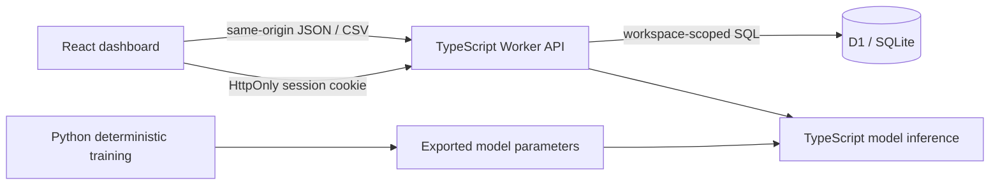

# AquaPulse · Industrial Water Intelligence

A full-stack portfolio application that turns simulated industrial-water readings into anomaly alerts, demand forecasts and transparent water-saving scenarios. Built as an independent SDE project inspired by public smart-water use cases. It is not affiliated with Ecolab and is not an industrial control system.

**Public demo:** [Open AquaPulse](https://aquapulse-water-intelligence.blondebiscuit2.chatgpt.site) · [Download complete source](https://aquapulse-water-intelligence.blondebiscuit2.chatgpt.site/aquapulse-source.zip)

The demo uses synthetic data and an isolated workspace for each visitor.

## What you can demonstrate

- Explore water consumption, operating conditions and abnormal readings across simulated facilities.
- Import validated CSV telemetry and export readings for analysis.
- Run real fitted machine-learning inference: Ridge regression estimates healthy demand, while Isolation Forest identifies unusual multivariate operating conditions.
- Inspect anomaly drivers and forecast bands, with model assumptions made explicit.
- Compare estimated savings under adjustable operating assumptions.
- Acknowledge and resolve incidents, with follow-up notes persisted in SQL.
- Retain an isolated demonstration workspace using an anonymous browser session.

All initial telemetry is **synthetic**. Forecasts and estimated savings demonstrate software behavior; they are not measured field results or operating recommendations. The [model card](ml/MODEL_CARD.md) records reproducible evaluation and its limits. Held-out demand-regression results use observed operating inputs; they are not a backtest of the entire future 24-hour forecast.

## Technology

| Layer | Implementation |
|---|---|
| User interface | React, TypeScript, Vite, Recharts, Lucide icons |
| HTTP service | TypeScript, Cloudflare Workers |
| Persistence | Cloudflare D1, SQLite migrations |
| Workspace identity | Trusted hosted identity when available; otherwise an anonymous HttpOnly session cookie |
| ML training | Python, scikit-learn Ridge regression and Isolation Forest |
| ML serving | Exported model parameters evaluated in TypeScript |
| Validation | TypeScript checks, Vitest, Python training/evaluation, GitHub Actions |

Azure is relevant to Ecolab's public digital platform, but **this application is not deployed to Azure**. A proposed Azure mapping is documented separately. [Company fit and sources](docs/company-fit.md).

## Run locally

Prerequisites: Node.js 22 or newer, npm, and Python 3.11 or newer for retraining. Running the app does not require a paid AI API key or a local Python server.

```bash
npm ci
npm run build
npm run db:local
npm run dev
```

Open the local URL printed by Wrangler. The build creates the browser assets and Worker bundle; rerun it after changes. The local D1 database is separate from any hosted database. For an anonymous local session, use one browser profile to retain the same demonstration workspace; clearing cookies creates a new one.

To check the source:

```bash
npm run typecheck
npm test
npm run build
```

To retrain and regenerate the exported model:

```bash
python -m venv .venv
source .venv/bin/activate
python -m pip install -r ml/requirements.txt
python ml/train.py
npm test
npm run build
```

On Windows, activate the virtual environment with `.venv\Scripts\activate`. See [the model card](ml/MODEL_CARD.md), `ml/metrics.json` and `ml/parity-fixtures.json` for evaluation details and Python/TypeScript inference fixtures. Retraining is not needed for the ordinary demo because inference uses the committed model export.

## Architecture



Python runs during model development, not on every request. Exporting a small model keeps the deployed service self-contained and makes inference reproducible. The API owns validation and persistence. The browser does not connect directly to SQL.

An anonymous workspace is appropriate for a synthetic portfolio demo. It is not enterprise authentication: the session cookie grants access to that workspace, and losing it loses access. The supported hosted environment can instead supply a trusted authenticated-user header. A production system would need organization membership, authorization, retention policies, ingestion identities, monitoring and further operational validation. [Identity details and independent-host requirements](docs/API.md#workspace-identity-and-persistence).

## Data and API

See [API and data reference](docs/API.md) for endpoint contracts, CSV columns, units, errors and isolation behavior. A reading identifies a facility and asset and contains a timestamp, flow, conductivity, temperature, pH and a production index. Preserve units when preparing an import.

The default dataset uses simulated facilities. Imported values are user-provided demo data, not Ecolab/customer records. Do not upload personal information, credentials or confidential operational data.

## Repository guide

```text
src/                    React interface and charts
server/                 Worker API, data validation and ML inference
migrations/             D1 / SQLite schema migrations
ml/                     Training, exported artifacts and model evaluation
tests/                  Automated checks
docs/                   API, company research, interview and publishing guides
.github/workflows/      Continuous integration
```

## Deployment and GitHub

The supported hosted build runs on Cloudflare Workers with a D1 binding. The repository contains its build and migration configuration. Apply database migrations to the intended environment before using an independently deployed instance. The hosted build and its SQL database are distinct resources.

[GitHub publishing instructions](docs/GITHUB.md) explain how to create your own repository when account authorization is unavailable. No GitHub repository or Azure deployment should be claimed until those actions have succeeded.

## Explain it in an interview

[The walkthrough](docs/INTERVIEW.md) gives a step-by-step demo, key design decisions, ML leakage checks, tradeoffs and useful extensions. [The Azure proposal](docs/AZURE.md) maps this implementation to relevant managed services without presenting the proposal as completed work.

Possible resume wording, after you have run the app and can explain the implementation:

> **AquaPulse — Industrial Water Intelligence** · React, TypeScript, Workers, SQL, Python, scikit-learn  
> Built a full-stack industrial-water telemetry application with validated CSV ingestion, workspace-scoped SQL persistence, interactive monitoring and incident workflows.  
> Trained and exported Ridge regression and Isolation Forest models for demand estimation and anomaly detection; documented synthetic-data evaluation and served inference through a TypeScript API.

Add your verified repository/demo links and reproducible evaluation figures only. Do not claim real water savings, production users, Ecolab collaboration or a shortlisting guarantee.

## License

MIT. See [LICENSE](LICENSE). Product names mentioned in the research belong to their respective owners.
