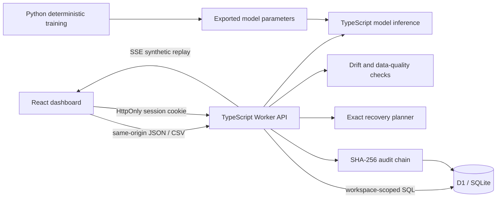

# AquaPulse · Industrial Water Intelligence

[](https://github.com/SrijanSingh2006/aquapulse-water-intelligence/actions/workflows/ci.yml)

A full-stack application that turns simulated industrial-water readings into anomaly alerts, demand forecasts and constrained recovery plans. Its responsive red-and-black interface combines interactive monitoring, model assurance, streamed fault replay and an auditable incident workflow.

**[Live demo](https://aquapulse-water-intelligence.blondebiscuit2.chatgpt.site)** · **[GitHub repository](https://github.com/SrijanSingh2006/aquapulse-water-intelligence)** · [Download source ZIP](https://aquapulse-water-intelligence.blondebiscuit2.chatgpt.site/aquapulse-source.zip)

Built as an independent CSE/SDE portfolio project inspired by public smart-water use cases. The demo uses synthetic data and an isolated workspace for each visitor. It is not affiliated with Ecolab and does not control industrial equipment.

## What you can demonstrate

- Explore water consumption, operating conditions and abnormal readings across simulated facilities.
- Import validated CSV telemetry and export readings for analysis.
- Run real fitted machine-learning inference: Ridge regression estimates healthy demand, while Isolation Forest identifies unusual multivariate operating conditions.
- Inspect anomaly drivers and forecast bands, with model assumptions made explicit.
- Compare estimated savings under adjustable operating assumptions.
- Acknowledge and resolve incidents, with follow-up notes persisted in SQL.
- Retain an isolated demonstration workspace using an anonymous browser session.
- Monitor feature drift against a frozen training reference and inspect data-quality findings.
- Replay synthetic healthy, leak and sensor-drift scenarios over Server-Sent Events, then explicitly commit a selected replay.
- Find the best recovery plan under a budget, crew limit and mutually exclusive site interventions using exact combinatorial search.
- Inspect a SHA-256-linked audit history, idempotent write behavior and request timing/trace metadata.

All initial telemetry is **synthetic**. Forecasts and estimated savings demonstrate software behavior; they are not measured field results or operating recommendations. The [model card](ml/MODEL_CARD.md) records reproducible evaluation and its limits. Held-out demand-regression results use observed operating inputs; they are not a backtest of the entire future 24-hour forecast.

## Technology

| Layer | Implementation |
|---|---|
| User interface | React, TypeScript, Vite, Recharts, Lucide icons |
| HTTP service | TypeScript, Cloudflare Workers |
| Persistence | Cloudflare D1, SQLite migrations |
| Workspace identity | Trusted hosted identity when available; otherwise an anonymous HttpOnly session cookie |
| ML training | Python, scikit-learn Ridge regression and Isolation Forest |
| ML serving | Exported model parameters evaluated in TypeScript |
| Model monitoring | Population Stability Index and explicit data-quality checks |
| Replay | Server-Sent Events over a streamed HTTP response |
| Recovery planning | Exact constrained combinatorial search and Pareto alternatives |
| Write integrity | D1 atomic batches, optimistic concurrency, idempotency receipts and SHA-256-linked audit events |
| API observability | Request IDs, W3C trace context, Server-Timing and OpenAPI 3.1 |
| Validation | TypeScript checks, Vitest, Python training/evaluation, GitHub Actions |

Azure is relevant to Ecolab's public digital platform, but **this application is not deployed to Azure**. A proposed Azure mapping is documented separately. [Company fit and sources](docs/company-fit.md).

## Run locally

Prerequisites: Node.js 22.13 or newer, npm, and Python 3.11 or newer for retraining. Running the app does not require a paid AI API key or a local Python server.

Clone the repository and install dependencies:

```bash
git clone https://github.com/SrijanSingh2006/aquapulse-water-intelligence.git
cd aquapulse-water-intelligence
npm ci
npm run build
npm run db:local
npm run dev
```

Open the local URL printed by Wrangler. The build creates the browser assets and Worker bundle; rerun it after changes. Generated hosted migrations live in `drizzle/`; run `npm run db:generate` after editing `db/schema.ts`. The local D1 database is separate from any hosted database. For an anonymous local session, use one browser profile to retain the same demonstration workspace; clearing cookies creates a new one.

Alternatively, extract the source ZIP linked above, enter its `aquapulse` directory and run the same npm commands.

To check the source:

```bash
npm run typecheck
npm test
npm run build
```

To retrain and regenerate the exported model:

```bash
python -m venv .venv
source .venv/bin/activate
python -m pip install -r ml/requirements.txt
python ml/train.py
npm test
npm run build
```

On Windows, activate the virtual environment with `.venv\Scripts\activate`. See [the model card](ml/MODEL_CARD.md), `ml/metrics.json` and `ml/parity-fixtures.json` for evaluation details and Python/TypeScript inference fixtures. Retraining is not needed for the ordinary demo because inference uses the committed model export.

## Architecture



Python runs during model development, not on every request. Exporting a small model keeps the deployed service self-contained and makes inference reproducible. The API owns validation and persistence. The browser does not connect directly to SQL.

An anonymous workspace is appropriate for a synthetic portfolio demo. It is not enterprise authentication: the session cookie grants access to that workspace, and losing it loses access. The supported hosted environment can instead supply a trusted authenticated-user header. A production system would need organization membership, authorization, retention policies, ingestion identities, monitoring and further operational validation. [Identity details and independent-host requirements](docs/API.md#workspace-identity-and-persistence).

## Data and API

See [API and data reference](docs/API.md) for endpoint contracts, CSV columns, units, errors and isolation behavior. [The advanced engineering guide](docs/ADVANCED.md) explains model assurance, streaming fault replay, constrained recovery planning, atomic writes and a recruiter demonstration. A reading identifies a facility and asset and contains a timestamp, flow, conductivity, temperature, pH and a production index. Preserve units when preparing an import.

The default dataset uses simulated facilities. Imported values are user-provided demo data, not Ecolab/customer records. Do not upload personal information, credentials or confidential operational data.

## Repository guide

```text
src/                    React interface and charts
server/                 Worker API, data validation and ML inference
db/                     Typed database schema
drizzle/                Generated SQL migrations and metadata
ml/                     Training, exported artifacts and model evaluation
tests/                  Automated checks
docs/                   API, company research, interview and publishing guides
.github/workflows/      Continuous integration
```

## Deployment and GitHub

The [public application](https://aquapulse-water-intelligence.blondebiscuit2.chatgpt.site) runs on Cloudflare Workers with a D1 binding through Sites hosting. The repository contains its build and migration configuration. Apply database migrations to the intended environment before using an independently deployed instance. The hosted build and its SQL database are distinct resources.

The source repository is [SrijanSingh2006/aquapulse-water-intelligence](https://github.com/SrijanSingh2006/aquapulse-water-intelligence). [The GitHub guide](docs/GITHUB.md) covers local checks and contribution workflow. GitHub Actions reproduces the ML artifacts, checks TypeScript, runs Vitest and builds the application; the badge above links to each run's status. A push to GitHub does not automatically deploy the app. Azure remains a documented architecture proposal.

## Explain it in an interview

[The walkthrough](docs/INTERVIEW.md) gives a step-by-step demo, key design decisions, ML leakage checks, tradeoffs and useful extensions. [The Azure proposal](docs/AZURE.md) maps this implementation to relevant managed services without presenting the proposal as completed work.

**AquaPulse — Industrial Water Intelligence** · React, TypeScript, Cloudflare Workers, D1/SQLite, Python, scikit-learn

- Built and deployed a responsive React/TypeScript dashboard with REST APIs on Cloudflare Workers and D1/SQLite persistence for validated CSV ingestion, telemetry analysis and incident management.
- Trained Ridge regression and Isolation Forest models in Python/scikit-learn, exported them for TypeScript inference, and verified Python–TypeScript numerical parity on synthetic industrial-water telemetry.
- Implemented Population Stability Index (PSI) drift monitoring, sensor-data quality checks and Server-Sent Events (SSE) fault replay with explicit, idempotent dataset commits.
- Developed an exact constrained optimization engine that evaluates budget, crew hours and mutually exclusive interventions, maximizing modeled net value and exposing a cost–water Pareto frontier.
- Engineered atomic SQL transactions with optimistic concurrency control, idempotency receipts and SHA-256-linked audit events, including chain verification against the workspace head.
- Documented OpenAPI 3.1 APIs, added W3C trace context and Server-Timing, and configured GitHub Actions CI to run 66 Vitest tests, TypeScript checks, reproducible ML artifact validation and builds.

[Copy the resume section and curated keywords](docs/RESUME.md). Explain the implementation and retain the synthetic-data qualifier. The project does not establish real water savings, production users or Ecolab collaboration.

## License

MIT. See [LICENSE](LICENSE). Product names mentioned in the research belong to their respective owners.
