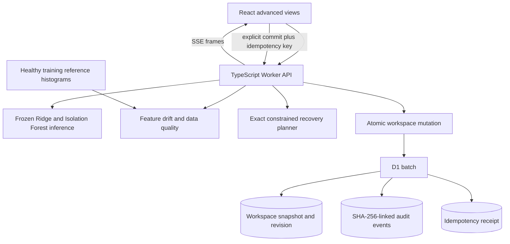

# Advanced engineering and recruiter demo

AquaPulse connects a trained model to monitoring, a streamed simulation and a resource-constrained decision workflow. The advanced features demonstrate applied SDE work using synthetic telemetry. Their outputs are inspectable software results, not verified industrial savings or autonomous controls.

## Architecture

The Python pipeline generates model parameters and the frozen statistical reference. The Worker runs inference and monitoring without retraining, calling an external AI provider or controlling equipment. The optimizer enumerates a bounded candidate space. The replay uses a real streamed HTTP protocol, with explicitly synthetic observations.

## Model assurance

Population Stability Index (PSI) compares current feature proportions with fixed bins from healthy training data. For proportions `p` and `q`, PSI sums `(p − q) × ln(p / q)` across bins, with smoothing to avoid division by zero. A changed distribution can signal a different operating regime, a fault or a sensor issue; it does not by itself establish model failure.

The reference is frozen and committed in `ml/reference.json`; an uploaded dataset cannot silently redefine “healthy.” It contains healthy-training decile histograms for normalized flow residual, conductivity, pH, production index and temperature, with per-site references and a model digest. At least 30 distinct usable observations per feature are required for a distribution assessment. A single site's 24-hour window correctly reports insufficient data. The additive smoothing parameter is 0.0001; PSI below 0.10 is labeled stable, below 0.25 watch and otherwise shifted. These thresholds are heuristics, not confidence levels.

Data-quality checks count actual site-hour coverage, duplicates, invalid/off-grid rows, stale sites and potentially stuck signals. A site is stale when its latest sample is over one hour behind the dataset clock. The clock is supplied explicitly or derived from the latest input timestamp, so a historical replay is not compared with today's wall clock. Stuck signals require six elapsed consecutive hours—seven hourly readings—within a metric-specific tolerance. The quality score subtracts bad-row and stuck-sensor penalties from completeness; it is not a certified rating. Inspect these findings before interpreting a high health percentage or a reassuring prediction.

Monitoring is separate from model evaluation. PSI does not measure anomaly precision, forecasting error or physical water safety. Historical replay timestamps and data-quality thresholds must be interpreted with the reference clock reported by the API.

## Synthetic fault replay

The replay streams named Server-Sent Events (SSE) over a same-origin HTTP response. Each scenario produces a bounded sequence of hourly observations for the selected sites, with model analyses attached. Scenarios include healthy operation, an excess-flow leak pattern and a sensor-drift pattern.

Streaming is a preview. It does not mutate the stored workspace. The operator must explicitly commit the replay to replace workspace readings and regenerate incidents. A commit carries an idempotency key so retrying the same accepted payload does not duplicate the mutation. Reusing a key for a different payload must be treated as a conflict.

This is a synthetic scenario generator and transport demonstration. It is not a connection to a physical IoT sensor, a persistent message broker or an industrial digital twin.

## Constrained recovery planning

The planner evaluates candidate interventions under a budget and crew-capacity limit, with at most one chosen intervention per site. The objective is `daily recovered m³ × horizon days × ₹/m³ − upfront cost`. Economic ties prefer lower cost, then stable action IDs. It reports the chosen plan alongside alternatives so the decision is explainable.

Exact enumeration is appropriate because this demo has at most six candidate actions, so at most 64 subsets are examined. The result is exact only for the listed candidates, numerical inputs, constraints and tie-break rules; it is not a guarantee that the physical intervention is optimal. The empty plan is always feasible and wins when no intervention has positive economic value.

Candidate water benefit uses each site's latest 24-hour window. Only model-flagged readings whose excess exceeds both 3 m³/h and 12% of expected flow contribute; chemistry-only anomalies generate no claimed water saving. The sum is divided by all observed hourly samples, including healthy hours, and extrapolated to a day. For partial windows this assumes the observed fault frequency persists.

Two mutually exclusive demo interventions recover 35% or 75% of that modeled daily excess. Costs and crew hours are fixed illustrative values in `server/planner.ts`. The Pareto frontier compares feasible plans on **cost and daily water recovery**, not crew-time dominance; equal cost/water points prefer lower crew time and stable IDs. The economic optimum can differ from the greatest-water plan. These assumptions are not field quotations or learned treatment effects, and the planner does not execute maintenance.

## Atomic writes and audit integrity

A successful write updates the workspace snapshot, appends an audit event and, for an idempotency-keyed import/commit, records a receipt through a D1 batch. A revision compare-and-swap prevents a stale reader from overwriting another mutation. The transaction must either accept the complete write or leave the old state intact. Reset restores demonstration readings and incidents while preserving this audit chain and recording the reset itself.

Audit events form a SHA-256 hash chain: each event includes the preceding hash and a digest of the current canonical event representation. Verification can detect altered or missing records relative to a trusted chain head. Hashing uses the runtime Web Crypto API.

This is tamper evidence under a trusted head, not absolute immutability. A database administrator able to rewrite all events and hashes can create a different internally consistent chain. Production assurance would need an independently trusted head, retention controls and authorization. An incident's current note remains an editable workflow field; the audit table is the separate append-only application history.

## Observable API behavior

API responses expose a request ID for correlation, `Server-Timing` for handler/setup timing and W3C `traceparent` context for tracing. SSE timing covers stream setup, not the full streaming lifetime. A trace identifier helps follow a request; it does not mean a full distributed tracing backend has been deployed.

The service also publishes an OpenAPI 3.1 description at `/api/openapi.json`. Use the schema and [API reference](API.md) when exercising the endpoints. The OpenAPI document describes the contract; tests and live requests verify actual behavior.

## A six-minute demonstration

1. **Set context.** Open the public demo, choose a facility and explain the hourly units and synthetic data source. Show an actual anomaly and its underlying sensor values.
2. **Inspect assurance.** Choose a seven-day window, show the frozen-reference drift comparison, sample count and data-quality findings. Explain why drift and prediction accuracy answer different questions. A 24-hour single-site window has fewer than the required 30 observations.
3. **Replay a fault.** Start a leak or sensor-drift scenario. Show frames arriving progressively and how the model response changes. Stop before committing to explain that preview and durable mutation are separate actions.
4. **Commit deliberately.** Commit one replay, reload and show the replaced dataset and generated incident. Explain the idempotency key and what should happen if the same request is retried.
5. **Plan a response.** Set a budget and crew limit. Inspect the chosen intervention set and an alternative. Tighten one constraint and explain why the feasible optimum changes.
6. **Show integrity.** Open the audit view and verification result. Explain the chain's trusted-head limitation. Inspect a response's request/trace/timing headers and the OpenAPI endpoint.
7. **Close with code.** Trace one mutation from route validation through compare-and-swap, the SQL batch and the receipt. Show a meaningful test and the reproducible training command, using actual output rather than a claimed test count.

## Resume wording

After running and explaining the implementation:

> Built an industrial-water telemetry demo with streamed fault replay, frozen-reference drift monitoring and an exact budget/crew-constrained recovery planner.  
> Implemented atomic workspace updates with optimistic concurrency, idempotency receipts and SHA-256-linked audit history; published a typed HTTP API with OpenAPI and request tracing metadata.

Use “simulated” or “synthetic” when describing evaluation or savings. Do not claim real plants, customer usage, achieved industrial savings, Kafka/Kubernetes infrastructure, an LLM or blockchain.
