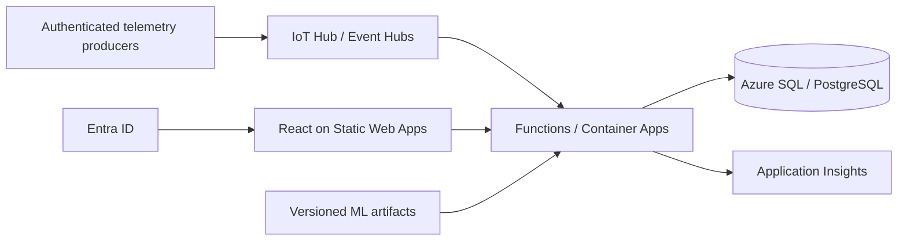

# Proposed Azure extension

This document is an architecture proposal. The project has **not** been deployed to Azure, and these services are not configured by this repository. Do not list them as implemented resume experience.

Ecolab publicly states that ECOLAB3D is built on Microsoft Azure. [Source](https://www.ecolab.com/en-us/media-center/expert-blog/ecolab3d-putting-real-time-data-to-work-for-industrial-water-management).

| Current component | Possible Azure replacement | Work still required |
|---|---|---|
| React static assets | Azure Static Web Apps or Storage static hosting | Configure build, routes, custom domain and access controls |
| TypeScript Worker HTTP API | Azure Functions or Container Apps | Adapt request/runtime interfaces, deployment and telemetry |
| D1 / SQLite | Azure SQL Database or managed PostgreSQL | Migrate schema/queries, connection handling, backups and authorization |
| Anonymous demonstration session | Microsoft Entra ID | Add sign-in, verified user/organization roles and tenant isolation |
| CSV/demo ingestion | IoT Hub or Event Hubs | Device identities, event schema, replay, idempotency and failure handling |
| Committed model export | Azure Machine Learning / artifact registry | Version training data and models, deployment gates and monitoring |
| Local logs/tests | Application Insights and Azure Monitor | Correlation IDs, service metrics, alerts and incident runbooks |
| GitHub checks | GitHub Actions or Azure DevOps deployment pipeline | Environment-specific approvals, federated identity and migrations |

Before adding this infrastructure, define a workload and budget, complete user authorization, choose an authentication/tenancy model and validate database semantics. Do not provision paid resources merely to add Azure to the technology list.
